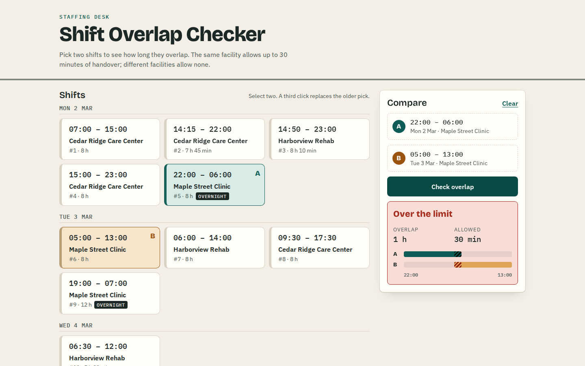
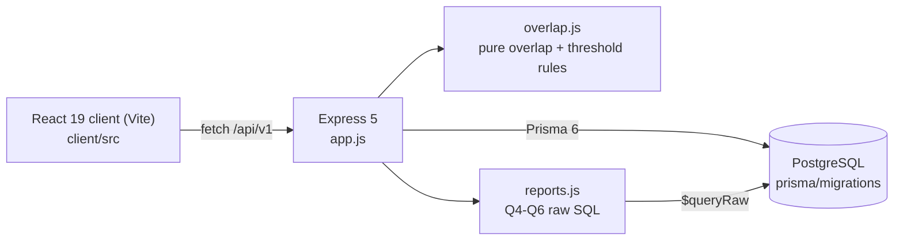
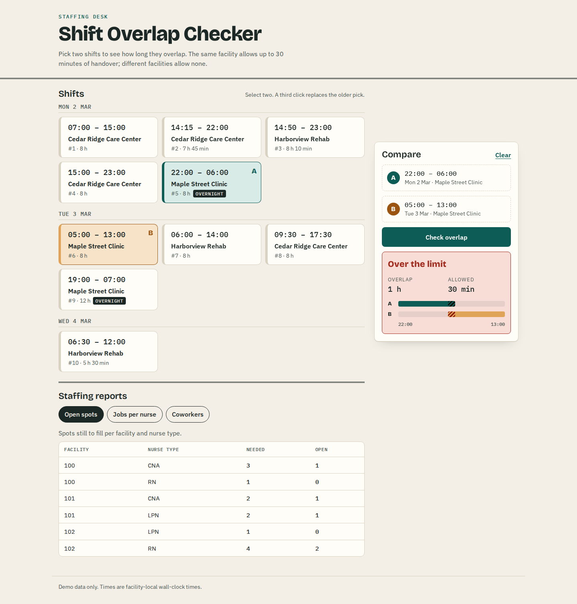
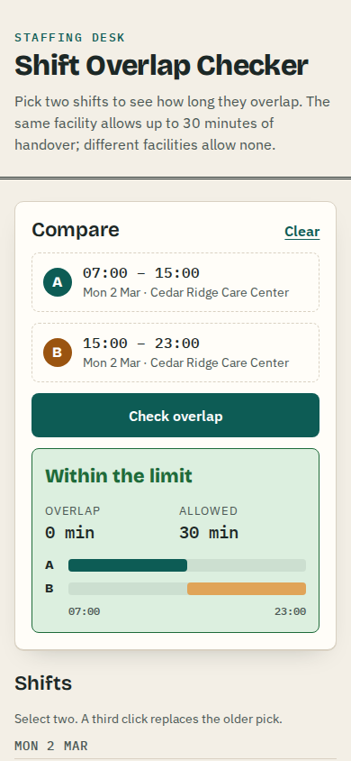

# Shift Overlap Checker

A small staffing tool built for the BravoCare take-home. Pick two nurse shifts and it tells
you how many minutes they overlap and whether that is more than the facility allows. It also
answers three staffing questions straight from SQL: open spots per facility, the jobs each
nurse could still take, and who has worked alongside a given nurse.



## Overlap rules

- **Overlap** is the time two shifts share, in minutes. Shifts that only touch (one ends at
  15:00, the next starts at 15:00) overlap by 0.
- **Overnight shifts:** a shift whose end time is earlier than its start time runs into the next
  day. 22:00–06:00 on 2 March therefore overlaps 05:00–13:00 on 3 March by 60 minutes. Shifts on
  different dates are compared on one timeline, not skipped.
- **Zero-length shifts** (start equals end) never overlap anything.
- **Threshold:** two shifts at the same facility may overlap by up to 30 minutes for handover.
  Shifts at different facilities, or without a facility, may not overlap at all.
  `exceeds_threshold` is `overlap > max_threshold`, so exactly 30 minutes is still allowed.
- **Timezones:** `shift_date`, `start_time` and `end_time` are Postgres `DATE` and `TIME`
  columns. They hold the facility's wall-clock time with no zone attached. Prisma returns them as
  UTC instants, and both the server and the browser read them in UTC. A server in any `TZ`,
  or a browser in New York, sees 22:00 as 22:00, and daylight-saving changes do not alter
  shift lengths.

## Quick start (Docker)

You need Docker with Compose v2.

```sh
docker compose up --build
```

Open <http://localhost:3000>. The app container applies the Prisma migrations, loads a
fictional demo rota (10 shifts, 3 facilities, 8 nurses) and serves both the API and the built
client. Postgres sits on an internal network that only the app can reach. To use another port,
skip the demo data or change the database password, copy `.env.example` to `.env` and set
`APP_PORT`, `SEED_DEMO_DATA=false` or `POSTGRES_PASSWORD`.

`docker compose down -v` stops everything and removes the database volume.

## Local development

You need Node 22 (see `.nvmrc`) and PostgreSQL 14 or newer.

```sh
cp .env.example .env              # then point DATABASE_URL at your database
npm ci
npx prisma migrate deploy
npm run db:seed                   # optional: the fictional demo rota
npm run dev                       # API on :3000, restarts on change

cd client
npm ci
npm run dev                       # Vite on :5173, proxies /api to :3000
```

`API_PROXY_TARGET` overrides where Vite sends `/api` during development. For a production-style
run, `npm run build` in `client/` and `npm start` at the root. The API then serves `client/dist`.

## Tests and lint

```sh
# server: node:test unit tests, plus supertest API tests against Postgres
DATABASE_URL=postgresql://... npx prisma migrate deploy
DATABASE_URL=postgresql://... npm test
npm run lint

# client: Vitest + Testing Library
cd client && npm test && npm run lint
```

The API tests reset the database to the demo seed, so point them at a scratch database. Without
`DATABASE_URL` they are skipped and only the overlap unit tests run.

- **Server:** 50 tests. The overlap unit tests cover partial, touching, identical, nested and
  zero-length shifts, midnight, month and year crossings, sub-minute `TIME(6)` precision, five
  `TZ` settings and a DST night. The API tests cover every endpoint, the validation errors and
  the report queries against known seed data.
- **Client:** 14 tests covering selection, the verdict, error and empty states, and reports.

## API

All routes are under `/api/v1`. Every example below was captured from the Compose stack with the
demo seed.

### `GET /question_one_shifts`

All shifts in date and start-time order, with the facility name.

```json
{"status":"success","data":{"question_one_shifts":[{"shift_id":1,"facility_id":100,
 "shift_date":"2026-03-02T00:00:00.000Z","start_time":"1970-01-01T07:00:00.000Z",
 "end_time":"1970-01-01T15:00:00.000Z","facility":{"facility_name":"Cedar Ridge Care Center"}}, ...]}}
```

### `POST /overlap`

```sh
curl -X POST localhost:3000/api/v1/overlap \
  -H 'Content-Type: application/json' -d '{"shift1": 5, "shift2": 6}'
```

```json
{"status":"success","data":{"overlap":60,"max_threshold":30,"exceeds_threshold":true}}
```

Back-to-back shifts at the same facility (`{"shift1": 1, "shift2": 4}`):

```json
{"status":"success","data":{"overlap":0,"max_threshold":30,"exceeds_threshold":false}}
```

| Status | When |
| --- | --- |
| 400 | an id is missing, not a positive integer, or both ids are the same |
| 404 | a shift does not exist, e.g. `{"status":"error","message":"Shift not found: 999"}` |
| 422 | a stored shift has no date or times |

### Staffing reports

| Route | Answers |
| --- | --- |
| `GET /q4` | open spots per facility and nurse type (jobs of the same type are summed) |
| `GET /q5` | for each nurse, the open jobs of their type they have not been hired for |
| `GET /q6?nurse=Anne` | nurses hired at any facility where that nurse works (default `Anne`) |

```json
GET /q4
{"result":[{"facility_id":100,"nurse_type_needed":"CNA","total_number_nurses_needed":3,"remaining_spots":1},
 ...,{"facility_id":102,"nurse_type_needed":"RN","total_number_nurses_needed":4,"remaining_spots":2}]}

GET /q6
{"nurse":"Anne","result":[{"nurse_name":"Carla"},{"nurse_name":"Dev"}]}
```

## How it fits together



- `overlap.js` has no I/O, which is why it can be tested exhaustively without a database. The
  client mirrors its interval logic in `client/src/time.js`, but only to draw the timeline. The
  numbers always come from the API.
- `app.js` exports `createApp({ prisma })` and `server.js` starts it, so the API tests run the
  real app against a real database with no mocked ORM.
- The report queries cast `COUNT`/`SUM` to `int` in SQL, so the JSON contains plain numbers
  instead of BigInt workarounds. Q6 binds the nurse name as a query parameter.





## Project layout

```
app.js, server.js        Express app factory and entry point
overlap.js               overlap and threshold rules
reports.js               staffing report SQL
prisma/                  schema, migrations and the demo seed
test/                    node:test unit and API tests
client/                  Vite + React 19 front end
Dockerfile, compose.yaml container image (runs as the node user) and stack
```

## License

MIT, see [LICENSE](LICENSE).
